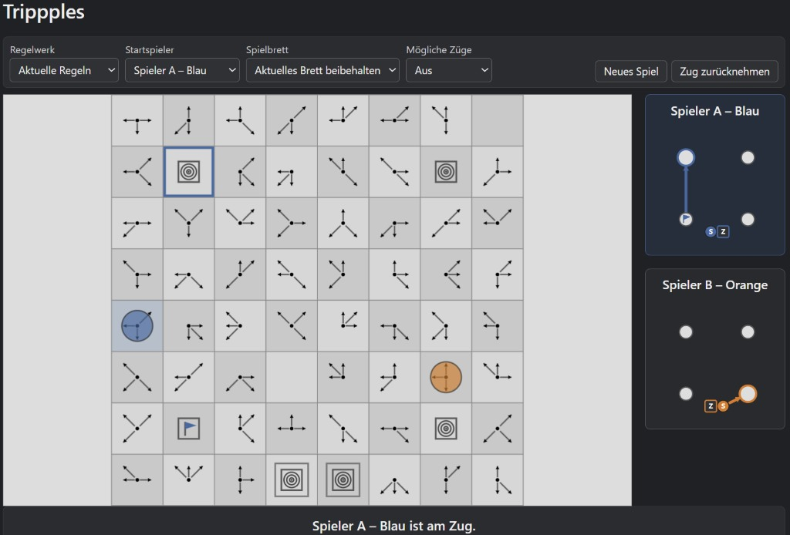

# Trippples — An Abstract Strategy Game Revisited

**Trippples** (deliberately spelled with three *p*s) is an abstract strategy board game designed by William T. Powers in the early 1970s. This project explores the game through a modern, browser-based implementation, beginning with a playable proof of concept.

The long-term goal is to bring this unusual game to modern platforms while preserving its original character and documenting the reasoning behind the implementation.

## Why This Project?

This project has a personal history that goes back almost three decades.

Back in 1997, I discovered Paul Kienitz's Amiga implementation of Trippples in C on an old Amiga Public Domain disk, most likely from the Fred Fish collection. I liked the game enough to write my own DOS conversion in Turbo Pascal.

And then, as these things sometimes do, the project disappeared into the back of my mind.

Fast-forward to very recently, when I came across a paper printout of my old Pascal source code while clearing out some long-forgotten stuff in the attic. Seeing it again brought the game back to life in my mind. Somehow, it suddenly seemed obvious: **this game deserves a new life on a modern platform — perhaps even on a mobile phone.**

Rather than jumping straight into a full-blown application, I decided to start small and build a proof of concept first. The immediate goal is to get the rules right, establish a sound technical foundation, and make the game playable in a modern browser.

Partly, this is about bringing an old piece of personal computing history back to life. But it's also about revisiting something I created almost thirty years ago, understanding it again with today's tools, and seeing where the idea can go from here.

Some projects never quite leave you. They just wait patiently in the attic.

## The Game

Trippples is played on an 8×8 board containing directional tiles. Each directional tile displays three arrows pointing in directions chosen from the eight possible directions of movement.

Its defining mechanic is unusual: **the tile occupied by your opponent's piece determines your available movement directions.** You must therefore consider not only your own position and route, but also how your opponent's position affects your next move.

The board combines directional tiles with starting positions, destinations, and other special fields. Players navigate the board according to the movement rules and attempt to complete their route before their opponent.

The precise setup and some gameplay details differ between surviving descriptions and later computer implementations. Reconstructing and documenting the rules is therefore an integral part of the project.

## Current Implementation

The project currently consists of a browser-based proof of concept built with HTML, JavaScript, and Canvas.

The implementation is deliberately modular:

- **`board.js`** — board representation, tile data, and board-related helpers.
- **`rules.js`** — movement rules and legal-move calculations.
- **`rulesets.js`** — definitions of the available rulesets.
- **`game.js`** — game state, turn management, and game logic.
- **`ui.js`** — board rendering and user interaction.
- **`main.js`** — application initialization and coordination.

The underlying principle is to keep game rules, game state, and presentation separate, making the logic easier to test and the implementation easier to extend.

### Current Features

- An interactive 8×8 game board.
- Local human-versus-human gameplay.
- Two selectable rulesets: **Current Rules** and **Classic Rules**.
- Ruleset switching with confirmation before the current game is discarded.
- Drag-and-drop movement.
- Visual indication of the active player's position.
- Distinct visual representations for blocked fields and route objectives.
- Two compact player maps showing route progress and the next objective.
- A responsive layout designed to accommodate different screen sizes and arrangements.
- A lightweight browser-based test runner covering rules, game logic, and UI behaviour.

The two rulesets provide different board configurations and starting positions while sharing the same underlying movement and game infrastructure. This makes it possible to explore different interpretations without duplicating the core implementation.

The test runner helps verify the underlying logic independently of manually playing through the interface.

## Reconstructing the Rules

One of the main challenges is determining which rules belong to the original commercial game and which details may have changed in subsequent implementations.

The research draws on historical rule material, contemporary descriptions, and surviving computer implementations. The original rulebook and historical sources take priority when discrepancies arise, while the Amiga implementation provides a valuable reference for understanding how a complete digital version handles practical gameplay situations.

The project currently offers two explicitly defined configurations rather than silently combining incompatible interpretations. Their setup and gameplay implications are documented separately.

See the accompanying documentation:

- **[Sources & Reference Material](SOURCES.md)** — historical sources, implementations, and their relative reliability.
- **[Game Rules](GAME_RULES.md)** — the implemented rulesets, gameplay mechanics, implementation decisions, and unresolved discrepancies.
- **[Architecture](ARCHITECTURE.md)** — the code structure, responsibilities of individual modules, and design decisions.

## Architecture and Design Principles

The proof of concept is being developed with a few straightforward principles in mind:

- **Separation of concerns:** rules and game state should not depend on rendering or UI details.
- **Testable logic:** legal moves, turn transitions, and winning conditions should be verifiable without interacting with the board manually.
- **Explicit decisions:** uncertain rules and deviations from historical sources should be documented.
- **Flexible presentation:** the board and supporting controls should adapt to different layouts instead of relying on fixed positioning.
- **Reusable rulesets:** alternative board configurations should use the same underlying game engine wherever possible.
- **Incremental development:** establish correct local gameplay before introducing networking or platform-specific features.

These principles are intended to keep the project understandable and maintainable as it grows.

## Future Direction

The current browser version is a foundation, not the final product.

The longer-term plan is to explore an Android version with online, turn-based multiplayer. A possible architecture would combine a REST API for conventional requests with WebSockets for real-time communication and turn updates.

Other areas for future investigation include:

- A computer opponent based on minimax search with alpha-beta pruning.
- Server-side move validation for online games.
- Adapting the game and its interface to mobile devices.

These are planned directions, not features of the current proof of concept. The immediate priority remains a sound, well-tested implementation of the game itself.

## Historical References

The following sources form the basis of the rule reconstruction:

- [Tripppin — Amiga implementation by Paul Kienitz](https://github.com/paulkienitz/Tripppin)
- [BoardGameGeek — Trippples](https://boardgamegeek.com/boardgame/2040/trippples)
- [Abstract Games — Issue 7 (PDF)](https://www.abstractgames.org/uploads/1/1/6/4/116462923/abstract_games_issue_7.pdf)
- [Original Trippples English rulebook (PDF)](https://tesera.ru/images/items/905121/Trippples%20ENG.pdf)
- [Don's Game Closet — Game Rules](https://www.donsgamecloset.com/GameRulesTpU.html)

For detailed notes on these references and the questions they raise, see [SOURCES.md](SOURCES.md).

---

*Trippples is an independent, exploratory software project inspired by a historical board game. The project is not affiliated with the original designer or publishers.*